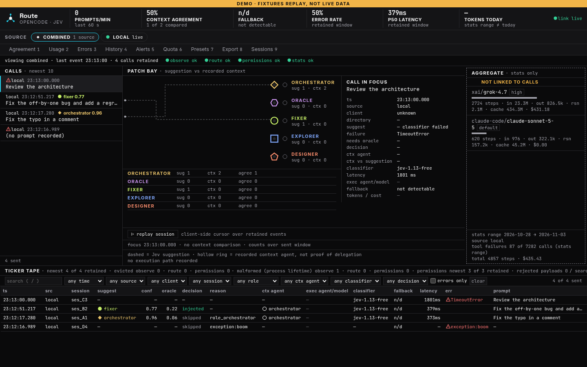

# Route


**Honest model routing observability.**

Route is a real-time, local-first switchboard for [OpenCode](https://opencode.ai) routing. It shows what actually happened (suggestions, context, routes, usage, errors) without inventing execution or attribution the logs cannot prove.

> `useroute.dev` is the planned public domain. It is not registered yet and no site is live there. For now, Route is this repository.



## Quickstart (2 minutes)

Requires [Bun](https://bun.sh) >= 1.2. [OpenCode](https://opencode.ai) is optional when you use an offline stats file or the DEMO fixtures.

```sh
bun install --frozen-lockfile
bun run start
# open http://127.0.0.1:4777
```

`bun run start` builds the assets and starts the dashboard, which listens on loopback only. Package and CLI are named `useroute`; the product is Route. `bun src/cli.ts --help` lists the commands: `serve` (default), `agent`, `snapshot`, `export`, `diagnose`.

**DEMO variant** (anonymized fixtures, no live OpenCode needed; every view is labeled DEMO):

```sh
ORD_STATE_DIR=fixtures ORD_STATS_FILE=fixtures/stats.json ORD_DEMO=true bun run start
```

Flags, remote agents, exports, snapshots and systemd units are in the [usage reference](docs/USAGE.md).

## Why Route

- **Honest labels.** Fixture replay is an explicit demo mode and every view says DEMO. Quota and usage are estimates from attributable evidence, with partial or unknown coverage shown. Unknown values are not treated as zero. Empty, partial, error, missing-source and truncated-window states are first-class.
- **Routing decisions, not invented execution.** The board shows Jev suggestions, recorded context, chosen routes, aggregate model usage and errors. It does not invent execution agents, per-message usage, fallback events or task-success metrics the logs cannot establish. Agreement is a context-only comparison, not a quality or delegation-success score. Aggregate stats are never allocated to individual calls.
- **Local-first, no product telemetry.** The dashboard binds `127.0.0.1` only (default port 4777). The [spec](docs/SPEC.md) forbids telemetry and unconfigured destinations, and the app never reads dotenv or credential files. `useroute diagnose` writes an allowlisted local preview and uploads nothing. When OpenCode stats are enabled, the child process runs with catalog/update/LSP downloads and `OTEL_EXPORTER_*` telemetry exporters disabled (this is not an OS network sandbox for plugins).

## What Route is not

- Not a hosted service or a live website.
- Not a general-purpose telemetry or cost platform.
- Not a complete session archive: it shows retained, transmitted events only.
- Not an execution engine: it observes routing and never runs, retries, approves or denies anything.
- Not a success meter: missing errors are not success.
- Not bundled with provider subscription limits: quota limits are user-supplied only.

## Status and roadmap

Version `0.2.0`. The BRAND visual redesign is on `develop`. Planned work and its approval boundaries are in [docs/ROADMAP.md](docs/ROADMAP.md); progress is on the [project board](https://github.com/users/crisesarmiento/projects/6). On the board, `Under evaluation` is not permission to implement.

More: [spec](docs/SPEC.md) · [design](docs/DESIGN.md) · [brand](docs/BRAND.md) · [verification](docs/VERIFICATION.md) · [known issues](docs/KNOWN_ISSUES.md) · [plan](docs/PLAN.md)

## Contributing

See [CONTRIBUTING.md](CONTRIBUTING.md). Before opening a PR, run:

```sh
bun run typecheck
bun run lint
bun test
bun run build
```

Contributor skill procedures are in [docs/AGENT_WORKFLOWS.md](docs/AGENT_WORKFLOWS.md).

## Reference

- [Usage reference](docs/USAGE.md): PC agent and SSH tunnel, configuration flags, anonymized demo, verification, views, range reports, `diagnose`, quota settings, snapshots, packaging and systemd units.
- [systemd migration notes](contrib/systemd/README.md)

## License

MIT
